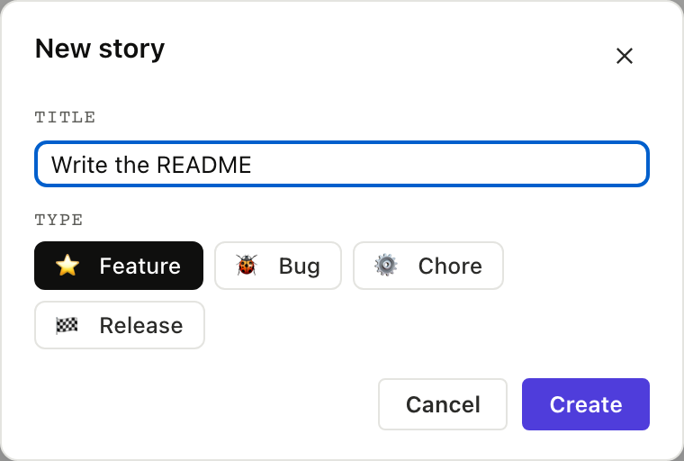
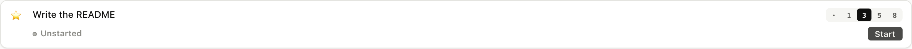
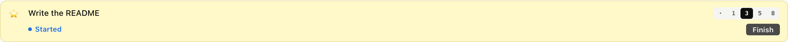

# 2. Your first story

With the inception written and the team agreements recorded, it is
time to create the first story.

A story is a markdown file with YAML frontmatter on top: title,
type, status, estimate, optional tags and epic. The body is plain
prose plus a `## Comments` and `## Tasks` section.

## 2.1 Create the story

New stories land in the icebox by default. The board's `+` buttons
and `am create-item` both default there; pass `--target priority`
if you want to skip straight to the ranked list.

<table>
<tr><th>Board</th><th>CLI</th><th>MCP</th></tr>
<tr>
<td></td>
<td>

```
$ am create-item "Write the README" --target icebox
created stories/write-the-readme.md
```

</td>
<td>

`create_item` takes a backlog and a title. The filename is derived
from the title (lowercase, dashes for spaces). Returns the path.

<details><summary>Full envelope</summary>

```json
{
  "jsonrpc": "2.0",
  "method": "tools/call",
  "params": {
    "name": "create_item",
    "arguments": {
      "backlog": "stories",
      "title": "Write the README"
    }
  }
}
```

</details>

</td>
</tr></table>

The new file looks like this:

```
---
title: Write the README
project: stories
type: feature
status: unstarted
author: <git user>
created: 2026-05-22T09:00:00Z
---

## Problem statement

(write what you're trying to do here)

## Comments
```

The body is yours to fill in, while the system tracks the frontmatter.

## 2.2 Estimate it

agilemarkdown uses Fibonacci-ish points (0, 1, 2, 3, 5, 8) and the
card carries an inline picker; features get pointed, while bugs,
chores, and releases stay unpointed.

<table>
<tr><th>Board</th><th>CLI</th><th>MCP</th></tr>
<tr>
<td></td>
<td>

```
$ am estimate stories/write-the-readme.md 3
✓ estimate: 3
```

</td>
<td>

`set_estimate` takes the path and a stringy estimate. The coach
gate catches >8 and refuses with a "split this story" hint.

<details><summary>Full envelope</summary>

```json
{
  "jsonrpc": "2.0",
  "method": "tools/call",
  "params": {
    "name": "set_estimate",
    "arguments": {
      "path": "stories/write-the-readme.md",
      "estimate": "3"
    }
  }
}
```

</details>

</td>
</tr></table>

## 2.3 Rank it into priority

A story in the icebox isn't on the team's plate yet. To say "this
is what we're working on next," promote it to priority. Drag from
Icebox into Backlog in the UI; `am unice` in the CLI; `move_to_priority`
in MCP.

<table>
<tr><th>Board</th><th>CLI</th><th>MCP</th></tr>
<tr>
<td></td>
<td>

```
$ am unice stories/write-the-readme.md --top
moved 1 item from icebox into priority (top)
```

</td>
<td>

`move_to_priority` promotes a story out of the icebox into the ranked
priority list. `position: "top"` ranks it first; omit it and the item
lands at the bottom. This is the MCP equivalent of dragging a card
from Icebox into Backlog.

<details><summary>Full envelope</summary>

```json
{
  "jsonrpc": "2.0",
  "method": "tools/call",
  "params": {
    "name": "move_to_priority",
    "arguments": {
      "backlog": "stories",
      "item_paths": ["stories/write-the-readme.md"],
      "position": "top"
    }
  }
}
```

</details>

</td>
</tr></table>

## 2.4 Start it

Status flips from `unstarted` to `started`, a `started:` timestamp
is stamped, and the card jumps to the top of the current sprint.

<table>
<tr><th>Board</th><th>CLI</th><th>MCP</th></tr>
<tr>
<td></td>
<td>

```
$ am start stories/write-the-readme.md
✓ status: started   started_at: 2026-05-22T09:00:00Z
```

</td>
<td>

`set_status` with `status: "started"`. This is the same tool
Chapter 4 uses for every other transition.

<details><summary>Full envelope</summary>

```json
{
  "jsonrpc": "2.0",
  "method": "tools/call",
  "params": {
    "name": "set_status",
    "arguments": {
      "path": "stories/write-the-readme.md",
      "status": "started"
    }
  }
}
```

</details>

</td>
</tr></table>

### What just happened

- A new story file landed in `stories/`
- Its estimate (3 points) lives in YAML frontmatter
- It moved from icebox to priority, top of the list
- Its status flipped to `started` and the timestamp stamped
- Every step was visible in the CommandLog tab as an `am` verb;
  every step was a JSON-RPC frame in the MCP Console.

Next: [The seeded backlog →](../03-meadow-intro/)
