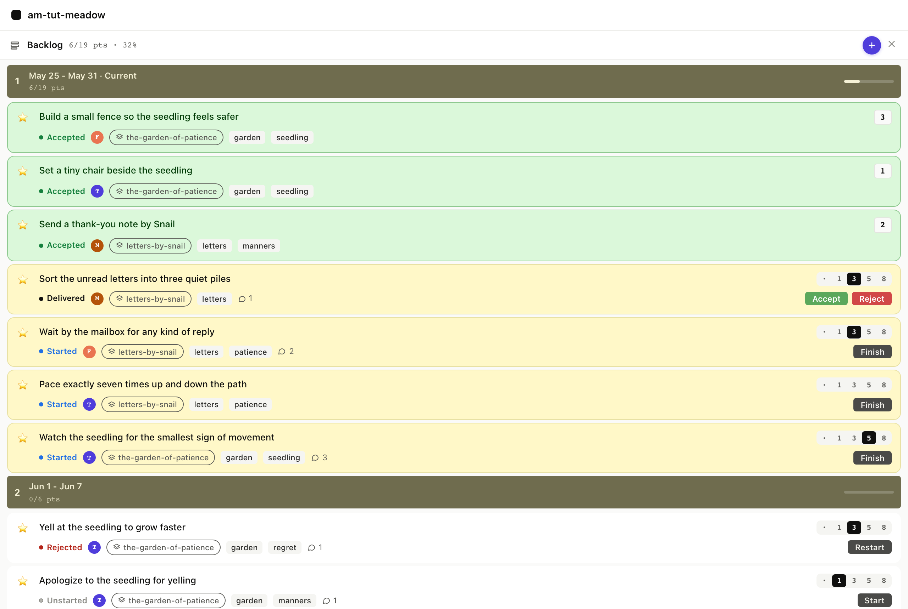
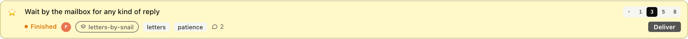
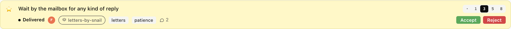
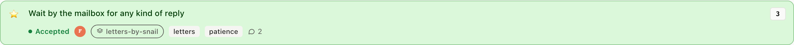

# 4. The current sprint

You've created a story, estimated it, ranked it, and started it.
That's the work-in-progress state. Now we walk it through the rest
of the sprint: finish, deliver, accept.

These four transitions are the daily loop: `started` is the dev
pair's pickup, `finished` says the code is complete, `delivered`
says the change is live where the PM can see it, and `accepted` is
the PM's call that the work is done. Every transition stamps a
timestamp on the story file, and those timestamps drive cycle
time, velocity, and the iteration band the story shows up in.

## 4.1 The board, at rest

Before any clicks, the current sprint band at the top of Backlog
stacks started stories on top with finished, delivered, and
accepted below, so the PM's eye lands first on what still needs
attention.

<table>
<tr><th>Board</th><th>CLI</th><th>MCP</th></tr>
<tr>
<td></td>
<td>

```
$ am show priority
Priority (stories)   velocity 7 / iteration

── Iteration 1377  Mon May 18  9 / 7 pts ──
   1. ★  Wait by the mailbox          started     3p
   2. ★  Pace exactly seven times     started     2p
   3. ★  Watch the seedling           started     5p
   4. ★  Build a small fence          accepted    3p
   5. ★  Set a tiny chair             accepted    1p
   6. ★  Send a thank-you note        accepted    2p
   7. ★  Sort the unread letters      delivered   3p
```

</td>
<td>

`priority_list` returns the same data the board renders. Backlog,
items, velocity, all the timestamps. The MCP Console's wire view
shows the JSON-RPC envelope.

<details><summary>Full envelope</summary>

```json
{
  "jsonrpc": "2.0",
  "id": 1,
  "method": "tools/call",
  "params": {
    "name": "priority_list",
    "arguments": { "backlog": "stories" }
  }
}
```

Response: `result.structuredContent.items` is an array of 18 rows,
each with status, estimate, type, assignees, tags, blocked,
comment_count, epic, and the started/finished/delivered/accepted
timestamps where they exist.

</details>

</td>
</tr></table>

## 4.2 Finish a started story

Wait by the mailbox is started. We finish it, code is complete,
the PM hasn't reviewed yet. The card stays in the current sprint;
the pill flips from blue (started) to orange (finished).

<table>
<tr><th>Board</th><th>CLI</th><th>MCP</th></tr>
<tr>
<td></td>
<td>

```
$ am finish stories/wait-by-the-mailbox-for-any-kind-of-reply.md
✓ status: finished   finished_at: 2026-05-22T08:37:46Z
```

</td>
<td>

`set_status` with `status: "finished"`. The transition stamps
`finished:` on the story file and leaves `started:` untouched so
cycle time still measures from first work.

<details><summary>Full envelope</summary>

```json
{
  "jsonrpc": "2.0",
  "method": "tools/call",
  "params": {
    "name": "set_status",
    "arguments": {
      "path": "stories/wait-by-the-mailbox-for-any-kind-of-reply.md",
      "status": "finished"
    }
  }
}
```

Response: `{"ok": true}` plus the snapshot WebSocket pushes the
updated board to every connected client.

</details>

</td>
</tr></table>

## 4.3 Deliver

Finished and delivered are distinct moments: finished says the dev
pair is done with the work, while delivered says the change is
live where the PM can review it. In a real project they are often
separated by a deploy pipeline.

<table>
<tr><th>Board</th><th>CLI</th><th>MCP</th></tr>
<tr>
<td></td>
<td>

```
$ am deliver stories/wait-by-the-mailbox-for-any-kind-of-reply.md
✓ status: delivered   delivered_at: 2026-05-22T08:37:46Z
```

</td>
<td>

`set_status` again, now with `status: "delivered"`. The transition
stamps `delivered:` and, if for any reason `finished:` was missing
(rare), back-fills it so the audit trail is complete.

<details><summary>Full envelope</summary>

```json
{
  "jsonrpc": "2.0",
  "method": "tools/call",
  "params": {
    "name": "set_status",
    "arguments": {
      "path": "stories/wait-by-the-mailbox-for-any-kind-of-reply.md",
      "status": "delivered"
    }
  }
}
```

</details>

</td>
</tr></table>

## 4.4 Accept

Accept is the PM's call, not the dev pair's. agilemarkdown's coach
mode actively prevents the dev pair from self-accepting; the GUI
makes the moment explicit by colouring the Accept button green and
placing it next to a red Reject.

Accept stamps `accepted:` on the story file. The card flips to the
success palette and loses its action buttons, accepted stories
are facts, not work.

<table>
<tr><th>Board</th><th>CLI</th><th>MCP</th></tr>
<tr>
<td></td>
<td>

```
$ am accept stories/wait-by-the-mailbox-for-any-kind-of-reply.md
✓ status: accepted   accepted_at: 2026-05-22T08:37:46Z
```

</td>
<td>

This is the same `set_status` call as every other transition, only
with `status: "accepted"`, and the coach refuses it from the dev
pair so only the PM ever sends it.

<details><summary>Full envelope</summary>

```json
{
  "jsonrpc": "2.0",
  "method": "tools/call",
  "params": {
    "name": "set_status",
    "arguments": {
      "path": "stories/wait-by-the-mailbox-for-any-kind-of-reply.md",
      "status": "accepted"
    }
  }
}
```

</details>

</td>
</tr></table>

### What just happened

- The card flips green, action buttons disappear, the story
  counts toward velocity
- Because the accepted date is in the current iteration, the
  story stays in the Backlog band (above the in-flight line)
- Next Monday's iteration tick will move it silently into
  the [Done panel](../08-done/); the timestamp does the routing,
  no manual archive needed

Next: [What happens when something gets rejected →](../05-when-things-go-wrong/)
