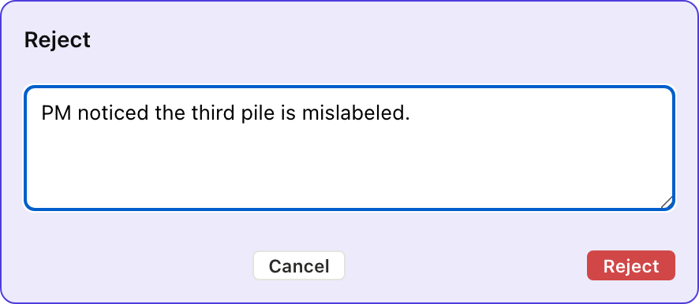

# 5. When things go wrong

Stories don't always go forward. The PM rejects one, the dev pair
realizes another shouldn't have been started, someone gets blocked
on external work.

## 5.1 Reject (with a reason)

Sort the unread letters has been delivered, and the PM notices on
review that the third pile is mislabeled. The red Reject button on
the delivered card flips the story back to `started`, records the
reason as a dated comment, and hands it back to the dev pair to
fix.

<table>
<tr><th>Board</th><th>CLI</th><th>MCP</th></tr>
<tr>
<td></td>
<td>

```
$ am reject stories/sort-the-unread-letters-into-three-quiet-piles.md \
    --reason "PM noticed the third pile is mislabeled."
✓ rejected, back to started
```

</td>
<td>

`reject_item` takes the path, the reason, and optionally the
author. It writes a comment under `## Comments` in the story body
and flips status back to `started` in one operation.

<details><summary>Full envelope</summary>

```json
{
  "jsonrpc": "2.0",
  "method": "tools/call",
  "params": {
    "name": "reject_item",
    "arguments": {
      "path": "stories/sort-the-unread-letters-into-three-quiet-piles.md",
      "reason": "PM noticed the third pile is mislabeled.",
      "author": "pm"
    }
  }
}
```

</details>

</td>
</tr></table>

### What just happened

- Status flipped to `started`, the story is in the dev pair's
  court again
- A dated comment landed under `## Comments`:
  *`@pm 2026-05-22, rejected, back to started. Reason: PM noticed
  the third pile is mislabeled.`*
- `accepted:` was cleared (it was never set, but `reject_item`
  guarantees it stays unset)
- The card moves back into the started cluster of the current sprint

## 5.2 Unstart

Sometimes the dev pair starts a story and realizes it should not
have, because it is the wrong story or it turns out to be larger
than expected. `unstart` is the reset, clearing the in-flight
timestamps and returning the story to `unstarted`.

<table>
<tr><th>Board</th><th>CLI</th><th>MCP</th></tr>
<tr>
<td></td>
<td>

```
$ am unstart stories/yell-at-the-seedling-to-grow-faster.md
✓ status: unstarted   started/finished/delivered/accepted cleared
```

</td>
<td>

`set_status` with `status: "unstarted"` does the same thing. It's
not a separate tool, the state machine treats `unstarted` as the
full reset.

<details><summary>Full envelope</summary>

```json
{
  "jsonrpc": "2.0",
  "method": "tools/call",
  "params": {
    "name": "set_status",
    "arguments": {
      "path": "stories/yell-at-the-seedling-to-grow-faster.md",
      "status": "unstarted"
    }
  }
}
```

</details>

</td>
</tr></table>

### What just happened

- Status reset to `unstarted`
- `started:`, `finished:`, `delivered:`, `accepted:` all cleared
- Cycle time will be measured from the next `am start` if the team
  comes back to this story (history is in git if you need to look)
- The card returns to the unstarted cluster below the in-flight line

## 5.3 Block

Blocked is different from rejected: the work has not gone wrong,
it simply cannot proceed because of something outside the dev
pair's control. Pace exactly seven times, for example, needs the
path to dry first.

<table>
<tr><th>Board</th><th>CLI</th><th>MCP</th></tr>
<tr>
<td></td>
<td>

```
$ am block stories/pace-exactly-seven-times-up-and-down-the-path.md \
    --reason "Path is wet from the rain. Waiting for it to dry."
✓ blocked
```

</td>
<td>

`block_item` writes a `blocked: true` flag plus `blocked_reason:` on
the story file. The board renders the card with a red Blocked chip
in place of the state pill. `unblock_item` clears both.

<details><summary>Full envelope</summary>

```json
{
  "jsonrpc": "2.0",
  "method": "tools/call",
  "params": {
    "name": "block_item",
    "arguments": {
      "path": "stories/pace-exactly-seven-times-up-and-down-the-path.md",
      "reason": "Path is wet from the rain. Waiting for it to dry."
    }
  }
}
```

</details>

</td>
</tr></table>

### What just happened

- `blocked: true` and `blocked_reason: …` landed on the story file
- The card's status pill is replaced by a Blocked chip
- The story stays in priority, blocked is a flag, not a column
  move. When the blocker clears, `am unblock` flips the flag and
  the story resumes as if nothing happened.

Next: [Epics roll up many stories →](../06-epics/)
