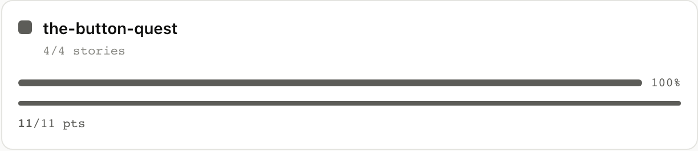
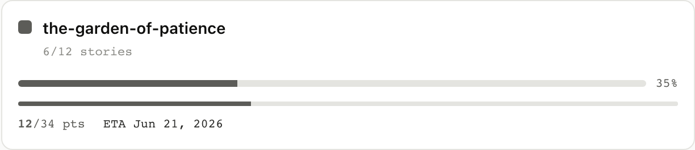
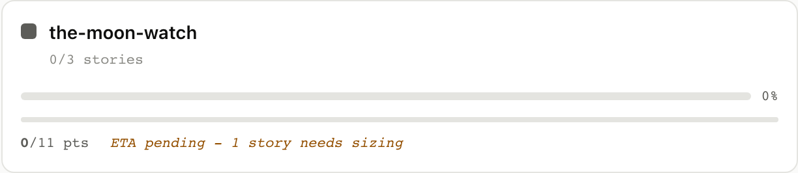

# 6. Epics and ETA

An epic in agilemarkdown is just a slug: any story with
`epic: <slug>` in its frontmatter belongs to it, and there is no
separate "epic" object beyond the slug itself. The board's Epics
column rolls each slug up into a card with counts, progress, and a
projected ship date.

## 6.1 A finished epic

`the-button-quest` is four stories, all accepted in prior weeks,
and the roll-up shows 4/4 stories, 11/11 points, 100%. No ETA is
needed since the epic is already history.

<table>
<tr><th>Board</th><th>CLI</th><th>MCP</th></tr>
<tr>
<td></td>
<td>

```
$ am show epic the-button-quest
Epic: the-button-quest   4/4 stories  11/11 pts  100%
[████████████████████████]

Accepted:
  ★  Count all the buttons in a small wooden box
  ★  Find a small white button
  ★  Look in the bushes near the pond
  ★  Wear the brown coat the whole afternoon
```

</td>
<td>

`epic_progress` returns the same counts plus the ASCII bar.

<details><summary>Full envelope</summary>

```json
{
  "jsonrpc": "2.0",
  "method": "tools/call",
  "params": {
    "name": "epic_progress",
    "arguments": { "slug": "the-button-quest" }
  }
}
```

Response: `{total_stories: 4, accepted_stories: 4, total_points:
11, accepted_points: 11, percent_done: 100, ascii: "..."}`.

</details>

</td>
</tr></table>

## 6.2 An in-flight epic with a projected ETA

`the-garden-of-patience` is twelve stories, six accepted, several
in flight, more unstarted in priority. Every story has an estimate,
so the client computes an ETA from `remaining_points / velocity`,
anchored to the next sprint Monday.

The card reads "6/12 stories, 12/34 pts, 35%, ETA Jun 21, 2026",
with the bar showing the visible fraction and the date showing
the math behind it.

<table>
<tr><th>Board</th><th>CLI</th><th>MCP</th></tr>
<tr>
<td></td>
<td>

```
$ am show epic the-garden-of-patience
Epic: the-garden-of-patience   6/12 stories  12/34 pts  35%
[████████░░░░░░░░░░░░░░░░]
```

</td>
<td>

ETA isn't computed server-side, the React tree does it from
`remaining_points` (everything not yet accepted) and the project
velocity from `priority_list`. The MCP tool returns the raw
numbers so any agent can compute its own projection.

<details><summary>Full envelope</summary>

```json
{
  "jsonrpc": "2.0",
  "method": "tools/call",
  "params": {
    "name": "epic_progress",
    "arguments": { "slug": "the-garden-of-patience" }
  }
}
```

</details>

</td>
</tr></table>

### What just happened (math)

```
remaining_points = total_points - accepted_points
sprints_to_ship  = ceil(remaining_points / velocity)
eta_monday       = next_monday + sprints_to_ship weeks
```

For the garden epic: `(34 − 12) / 7 ≈ 4 sprints`. Counting that
many sprint Mondays out from the current sprint lands on the date
the card shows, Jun 21, 2026.

## 6.3 An epic that can't be projected

`the-moon-watch` is three stories, two with point estimates and
one (brew the tea) still unsized. The card shows the counts it has
(0/3 stories, 0/11 pts) but refuses to commit to a date, surfacing
*ETA pending, 1 story needs sizing* in its place. The rule is that
agilemarkdown will not fake a forecast it cannot compute: as soon
as the missing estimate lands the ETA appears.

<table>
<tr><th>Board</th><th>CLI</th><th>MCP</th></tr>
<tr>
<td></td>
<td>

```
$ am show epic the-moon-watch
Epic: the-moon-watch   0/3 stories  0/11 pts  0%
[░░░░░░░░░░░░░░░░░░░░░░░░]
```

</td>
<td>

`epic_progress` returns the counts and `total_points` (here, the 11
points from the two estimated stories); the structuredContent does
not include an ETA because there is none to compute. The React
layer compares the per-story estimates from `priority_list` against
the epic's total story count and shows the "ETA pending" indicator
when a story is missing one.

<details><summary>Full envelope</summary>

```json
{
  "jsonrpc": "2.0",
  "method": "tools/call",
  "params": {
    "name": "epic_progress",
    "arguments": { "slug": "the-moon-watch" }
  }
}
```

</details>

</td>
</tr></table>

Next: [Release markers are date stakes →](../07-release-markers/)
