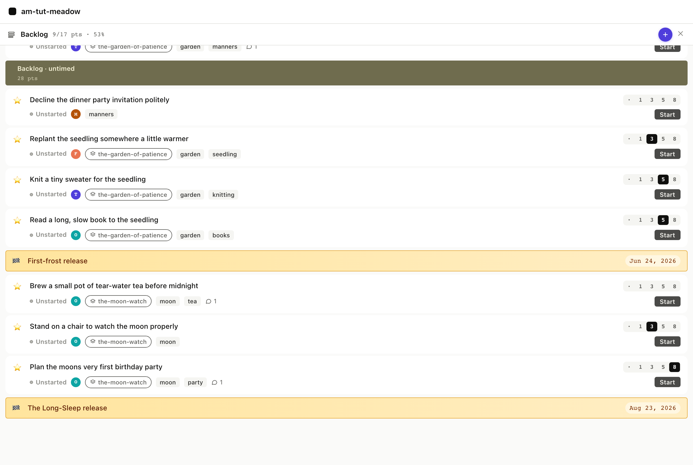
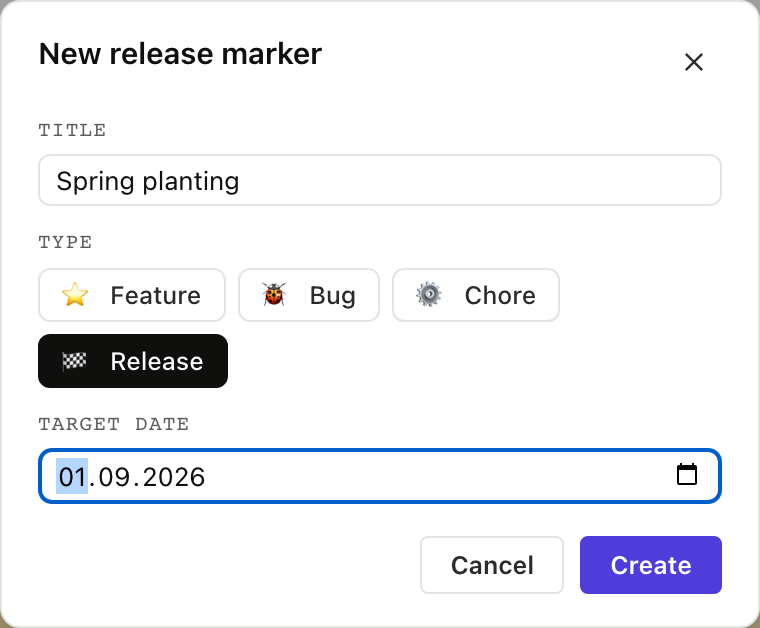

# 7. Release markers

A release marker is a story with `type: release` and a
`release_date`, acting as a date stake in the priority list that
says *"everything above this needs to ship by then."*

The meadow fixture has two: **First-frost** (target Jun 17) and
**The Long-Sleep** (target Aug 16, when Bear hibernates). They sit
at meaningful seams, outdoor work above First-frost, indoor work
above The Long-Sleep.

## 7.1 The marker in the backlog

In the board, release markers render as a horizontal amber bar
with a checkered flag and the target date in a pill. They're
visually distinct from story cards because they aren't stories.

Their position in the priority list determines whether the system
says they're on track or LATE. `am show priority` walks down the
list, accumulates points against velocity, and when it crosses
the marker's row asks whether the running iteration lands before
the release date: if so the marker is on track, otherwise it is
LATE.

<table>
<tr><th>Board</th><th>CLI</th><th>MCP</th></tr>
<tr>
<td></td>
<td>

```
$ am show priority --iterations 5
...
── Backlog (untimed) ──
  ★  Replant the seedling          unstarted   3p
  ★  Knit a tiny sweater            unstarted   5p
  ★  Read a long, slow book         unstarted   5p
  ▶  First-frost release            unstarted
       on track: target 2026-06-17
  ★  Brew a small pot of tea        unstarted
  ★  Stand on a chair               unstarted   3p
  ★  Plan the moon's birthday       unstarted   8p
  ▶  The Long-Sleep release         unstarted
       on track: target 2026-08-16
```

</td>
<td>

`priority_list` returns release markers in the same items array,
distinguished by `type: "release"` and a `release_date` field.

<details><summary>Full envelope</summary>

```json
{
  "jsonrpc": "2.0",
  "method": "tools/call",
  "params": {
    "name": "priority_list",
    "arguments": { "backlog": "stories" }
  }
}
```

The on-track / LATE projection is rendered by `iteration_view`
which the agent calls explicitly when it needs the math; the raw
row in `priority_list` just carries the date.

</details>

</td>
</tr></table>

Re-rank a story above First-frost and the projection might flip to
LATE; agilemarkdown recomputes whenever the list changes.

## 7.2 Creating a release marker

In the New Story modal a fourth type chip 🏁 release reveals a
date picker when selected; submit the form and the new marker
lands in priority. From the CLI it takes three calls (`create-item`,
`set-type`, `set-release-date`):

<table>
<tr><th>Board</th><th>CLI</th><th>MCP</th></tr>
<tr>
<td></td>
<td>

```
$ am create-item "Spring planting"
created stories/spring-planting.md
$ am set-type stories/spring-planting.md release
spring-planting.md type=release
$ am set-release-date stories/spring-planting.md 2026-09-01
spring-planting.md release_date=2026-09-01
```

</td>
<td>

The web modal does the same three operations in sequence. The
MCP equivalent is two tool calls: `create_item` and
`set_release_date` (there's no `set_type` MCP tool, agents
edit the story file directly via `set_description` or via
the type-aware variants of other tools).

<details><summary>Full envelope</summary>

```json
{
  "jsonrpc": "2.0",
  "method": "tools/call",
  "params": {
    "name": "create_item",
    "arguments": { "backlog": "stories", "title": "Spring planting" }
  }
}
```

then

```json
{
  "jsonrpc": "2.0",
  "method": "tools/call",
  "params": {
    "name": "set_release_date",
    "arguments": {
      "path": "stories/spring-planting.md",
      "release_date": "2026-09-01"
    }
  }
}
```

</details>

</td>
</tr></table>

## 7.3 Shipping a release

The day the release ships, the marker gets accepted. On the bar,
once the target date is today or earlier, a green **Ship** button
appears. Click it; agilemarkdown stamps `accepted: <now>` and the
marker rolls into the [Done panel](../08-done/) at its actual
ship week. The CLI verb is just `am accept`.

<table>
<tr><th>Board</th><th>CLI</th><th>MCP</th></tr>
<tr>
<td></td>
<td>

```
$ am accept stories/first-frost-release.md
✓ status: accepted   accepted_at: 2026-06-17T12:00:00Z
```

</td>
<td>

Shipping a marker is the same `set_status` call with
`status: "accepted"`, run against the release item. Release stories
skip started/finished/delivered, so accepting one simply stamps its
ship date and rolls it into Done.

<details><summary>Full envelope</summary>

```json
{
  "jsonrpc": "2.0",
  "method": "tools/call",
  "params": {
    "name": "set_status",
    "arguments": {
      "path": "stories/first-frost-release.md",
      "status": "accepted"
    }
  }
}
```

</details>

</td>
</tr></table>

The marker leaves the active priority view once accepted; next
Monday it moves to Done. The ship date in Done is a fact and does
not get recomputed when velocity shifts.

Next: [The Done panel is just history →](../08-done/)
