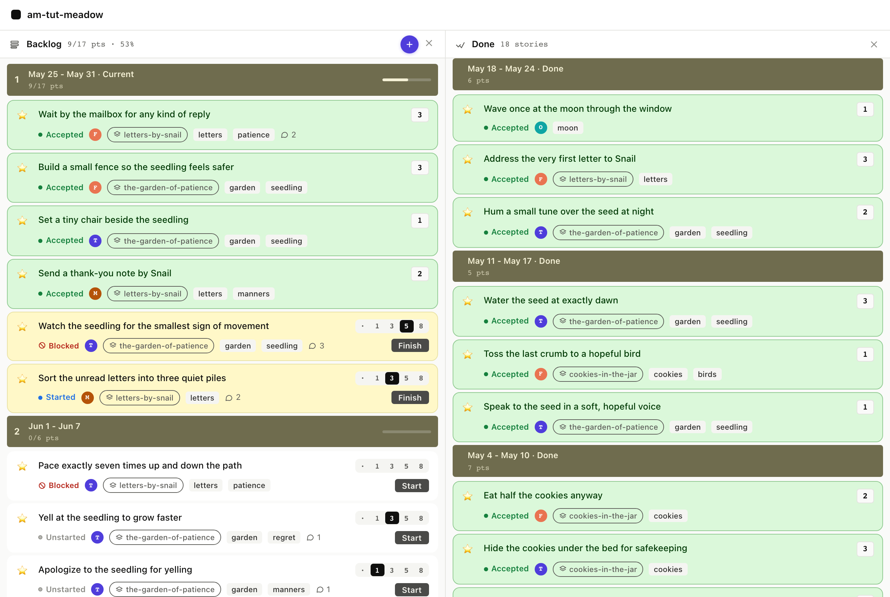

# 8. The Done panel

Done is what shipped, grouped by the iteration it shipped in.
The bands are facts: once a story was accepted in week N, that's
where it lives forever. agilemarkdown doesn't re-bin Done by
current velocity or any other moving target.

## 8.1 What shows up

The Done panel filters every story where:

1. `status` is `accepted`, **and**
2. the `accepted` timestamp falls in a *prior* iteration
   (not the current one).

Stories accepted in the current iteration stay in the Backlog
band above the in-flight line. The moment Monday's tick advances
the current iteration number, those accepted stories silently
roll into Done without any batch job or archive step; the row and
the file are the same, but the filter result is different because
`now` advanced.

<table>
<tr><th>Board</th><th>CLI</th><th>MCP</th></tr>
<tr>
<td></td>
<td>

```
$ am show done
Done (stories)   18 stories

── Iteration 1376  Mon May 11 ──
   1. ★  Wave once at the moon         accepted    1p
   2. ★  Address the very first letter accepted    3p
   3. ★  Hum a small tune over the seed accepted   2p

── Iteration 1375  Mon May 04 ──
   4. ★  Water the seed at exactly dawn accepted    3p
   5. ★  Toss the last crumb            accepted    1p
   6. ★  Speak to the seed softly       accepted    1p

   ... and so on for prior iterations
```

</td>
<td>

`done_list` returns the same rows, newest first, with the
`accepted` ISO timestamp on each. The client groups them by
iteration in the UI; the API just hands you the list.

<details><summary>Full envelope</summary>

```json
{
  "jsonrpc": "2.0",
  "method": "tools/call",
  "params": {
    "name": "done_list",
    "arguments": { "backlog": "stories" }
  }
}
```

Response: `result.structuredContent.items` is an array sorted
descending by `accepted` timestamp. Each row has the full
OrderRow shape, same one as `priority_list`, so a client
can render a Done card identically to a priority card.

</details>

</td>
</tr></table>

## 8.2 The Friday retro

`am retro` reads the same accepted-story timeline shown above and
folds in this iteration's headline numbers: velocity, volatility,
cycle time, rejection rate. Print it before the team sits down on
Friday and there is a starting agenda. Anything the team wants to
remember coming out of the conversation goes into
`.am/learnings.md` via `record-learning`. The retro view prints
those back under "Recent learnings", so the next Friday's retro
starts by reading them.

<table>
<tr><th>Board</th><th>CLI</th><th>MCP</th></tr>
<tr>
<td>

There is no agilemarkdown surface for the retro itself, so the
team can use a whiteboard, a markdown file, or anything else.
agilemarkdown supplies the summary view (`am retro`) and remembers
what comes out of the conversation in `.am/learnings.md`, both of
which are plain files in the repo.

</td>
<td>

```
$ am retro
Retro summary

  velocity:        7 pts
  volatility:      22%
  cycle time:      21.2d (median)
  rejection rate:  0% (latest, target band 5-15%)
  accepted total:  21
  rejected total:  1

Three questions:
  1. What worked?
  2. What did not work?
  3. What changes for next iteration?

Recent learnings:
  - On the morning of 2026-05-07: yelling at the seedling
    did not help. We have agreed to try kindness instead.
  - On the afternoon of 2026-05-14: the cookies were better
    when shared. We will remember this.

$ am record-learning "Pointing the gnarly one first kept the rest honest."
- 2026-05-28: Pointing the gnarly one first kept the rest honest.
```

</td>
<td>

`record_learning` appends a dated bullet to `.am/learnings.md` and
returns the line it wrote. There is no separate `retro` MCP tool; the
summary is a human-facing CLI surface. Agents participate by recording
what came out of the conversation.

<details><summary>Full envelope</summary>

```json
{
  "jsonrpc": "2.0",
  "method": "tools/call",
  "params": {
    "name": "record_learning",
    "arguments": {
      "note": "Pointing the gnarly one first kept the rest honest."
    }
  }
}
```

Response: `result.structuredContent.entry` is the dated line that
was written; `result.structuredContent.path` is `.am/learnings.md`.

</details>

</td>
</tr></table>

### What just happened

- `priority_list` and `done_list` are mutually exclusive filters
  over the same underlying data. A story is in exactly one of
  them at any moment, decided by the timestamp.
- The iteration bands in the Done panel are derived from each
  row's `accepted` date, not from "current iteration minus N".
  A story shipped in May 4's week stays under "May 4" forever.
- Release markers shipped in the past appear here too, anchored
  to their `accepted` (ship) date.
- `am retro` reads the same accepted-story data and adds the
  iteration's numbers, so the Friday meeting has an agenda
  without a separate setup step.
- Learnings recorded with `record-learning` accumulate in
  `.am/learnings.md` and surface in the next retro's "Recent
  learnings" section.

Next: [Find things three ways →](../09-search/)
