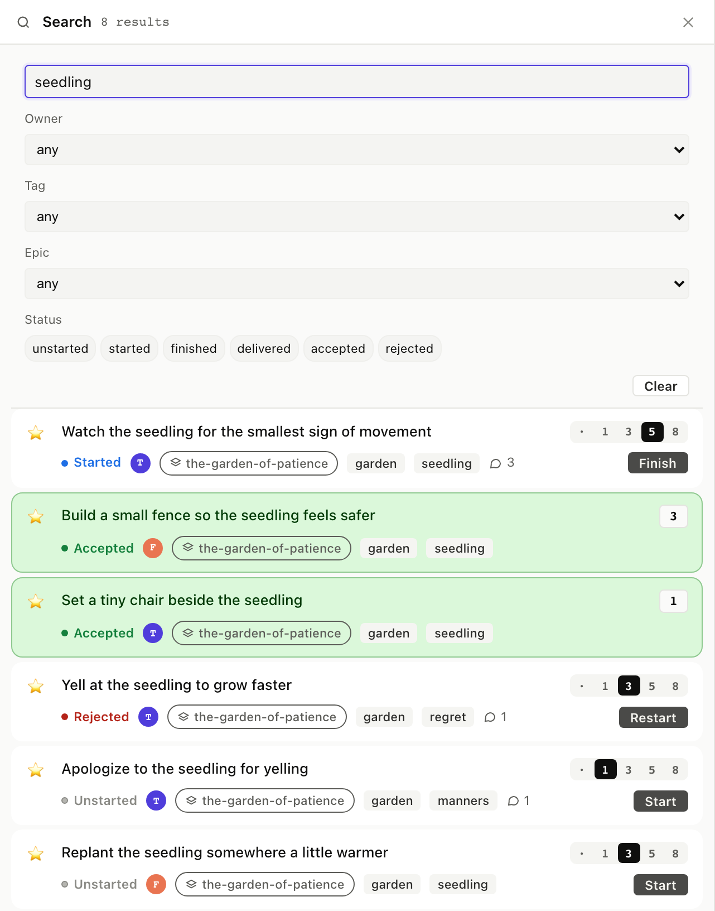
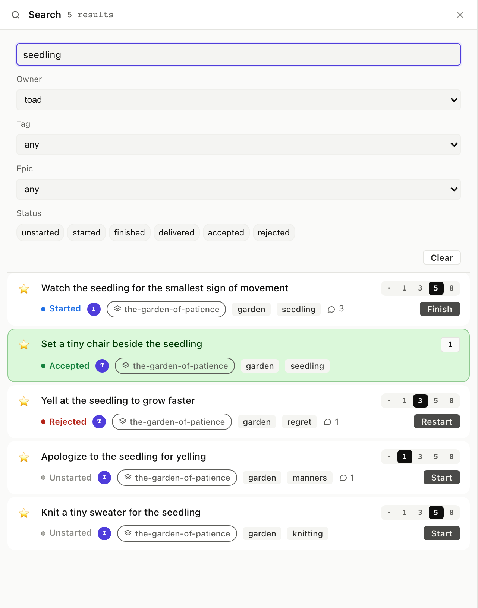

# 9. Search and filter

agilemarkdown offers three ways to narrow the view: free-text
search, structured filters (owner, tag, epic, status), and
double-click pivots that open a column scoped to one tag or one
epic. All three operate on the same data and differ only in how
you express the query.

## 9.1 Text search

The Search column has a text input. It matches your query as a
substring across title and path, lower-cased and trimmed.

<table>
<tr><th>Board</th><th>CLI</th><th>MCP</th></tr>
<tr>
<td></td>
<td>

```
$ am search "seedling"
... matching stories with titles or bodies containing "seedling"
```

</td>
<td>

The `search` tool takes a query and optional limit. Returns ranked
matches with snippets.

<details><summary>Full envelope</summary>

```json
{
  "jsonrpc": "2.0",
  "method": "tools/call",
  "params": {
    "name": "search",
    "arguments": { "query": "seedling", "limit": 5 }
  }
}
```

</details>

</td>
</tr></table>

## 9.2 Filter by owner / tag / epic / status

The Search column's form has four dropdowns and a status row.
Combine them: text "seedling" + owner "toad" returns only Toad's
seedling stories. Empty fields are wildcards.

<table>
<tr><th>Board</th><th>CLI</th><th>MCP</th></tr>
<tr>
<td></td>
<td>

```
$ am list-items stories --tag garden
... 13 stories tagged garden, one per line with status + estimate

$ am list-items stories --status accepted
... all currently-accepted stories
```

</td>
<td>

`list_items` is the structured search. Args: `backlog`, `status`,
`tag`, `assignee`, `epic`. Returns the OrderRow shape so a client
can render search results identically to a priority list.

<details><summary>Full envelope</summary>

```json
{
  "jsonrpc": "2.0",
  "method": "tools/call",
  "params": {
    "name": "list_items",
    "arguments": { "backlog": "stories", "tag": "garden" }
  }
}
```

</details>

</td>
</tr></table>

## 9.3 Pivots: double-click a tag or epic

Any tag chip on a story card double-clicks open to a Tag filter
column, and any epic chip (or any Epics column card) opens an Epic
filter column with the EpicCard rendered as the header.

<table>
<tr><th>Board</th><th>CLI</th><th>MCP</th></tr>
<tr>
<td></td>
<td>

There's no dedicated CLI verb for "open a filter column", the CLI
expresses the same idea with `am list-items --tag <slug>` or
`am show epic <slug>`. The board's pivot is a UI affordance over
those queries.

</td>
<td>

Same. The double-click is sugar over `list_items`.

</td>
</tr></table>

Results render with full StoryCard behavior: click a result card to
open the detail panel, click its action button to flip status
without leaving the search.

Next: [Conversation around a story →](../10-comments-tasks/)
