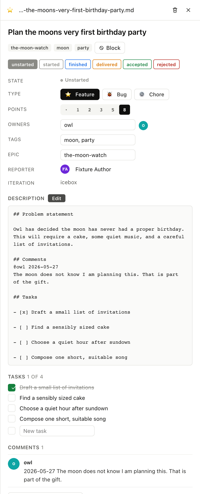
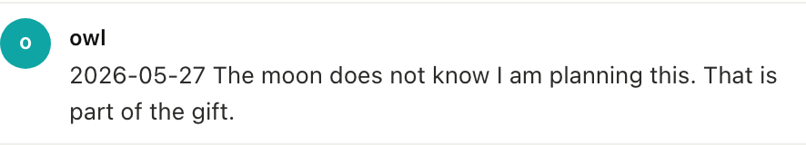
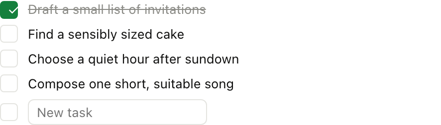

# 10. Comments and tasks

A story keeps its in-line discussion and substeps in the same file
as the metadata, with comments under `## Comments` and tasks under
`## Tasks`, so opening the file in any editor shows the whole
conversation at once.

## 10.1 The detail panel

Clicking a story card opens the DetailPanel (the same shape the
VS Code extension uses), with story metadata at the top, the body
in the middle, and comments and tasks below; any of them can be
edited inline.

<table>
<tr><th>Board</th><th>CLI</th><th>MCP</th></tr>
<tr>
<td></td>
<td>

```
$ am get-item stories/plan-the-moons-very-first-birthday-party.md
... full frontmatter + body + comments + tasks
```

</td>
<td>

`get_item` returns the whole story. `get_comments` and `list_tasks`
return just the section the agent needs.

<details><summary>Full envelope</summary>

```json
{
  "jsonrpc": "2.0",
  "method": "tools/call",
  "params": {
    "name": "get_comments",
    "arguments": {
      "path": "stories/plan-the-moons-very-first-birthday-party.md"
    }
  }
}
```

</details>

</td>
</tr></table>

## 10.2 Add a comment

Each comment is dated and attributed. The author is the lowercase
nickname of a user that exists in `.am/users/`.

<table>
<tr><th>Board</th><th>CLI</th><th>MCP</th></tr>
<tr>
<td></td>
<td>

```
$ am comment stories/plan-the-moons-very-first-birthday-party.md \
    "Maybe Owl should bake the cake?" --author frog
✓ comment added
```

</td>
<td>

`add_comment` takes path, text, and an optional author. If author
is omitted the system uses the current git user.

<details><summary>Full envelope</summary>

```json
{
  "jsonrpc": "2.0",
  "method": "tools/call",
  "params": {
    "name": "add_comment",
    "arguments": {
      "path": "stories/plan-the-moons-very-first-birthday-party.md",
      "text": "Maybe Owl should bake the cake?",
      "author": "frog"
    }
  }
}
```

</details>

</td>
</tr></table>

### What the file looks like after

The comment lands under `## Comments`:

```
## Comments
@owl 2026-05-21
The moon does not know I am planning this. That is part of the gift.

@frog 2026-05-22
Maybe Owl should bake the cake?
```

## 10.3 Add a task and tick it

Tasks are a markdown checkbox list: not separate stories, but
ordered substeps on one story.

<table>
<tr><th>Board</th><th>CLI</th><th>MCP</th></tr>
<tr>
<td></td>
<td>

```
$ am task add stories/plan-the-moons-very-first-birthday-party.md \
    "Find a stand for the cake"
✓ task added

$ am task tick stories/plan-the-moons-very-first-birthday-party.md 2
✓ task toggled
```

</td>
<td>

`add_task` appends. `set_task_done` flips the checkbox by 1-based
index.

<details><summary>Full envelope</summary>

```json
{
  "jsonrpc": "2.0",
  "method": "tools/call",
  "params": {
    "name": "set_task_done",
    "arguments": {
      "path": "stories/plan-the-moons-very-first-birthday-party.md",
      "index": 2
    }
  }
}
```

</details>

</td>
</tr></table>

### What just happened

- A new line landed under `## Tasks` as `- [ ] Find a stand…`
- Ticking flipped the second item from `- [ ]` to `- [x]`
- The DetailPanel's task list re-renders; the file is the
  source of truth and git tracks every change.

Next: [How an AI agent uses all of this →](../11-mcp-and-agents/)
