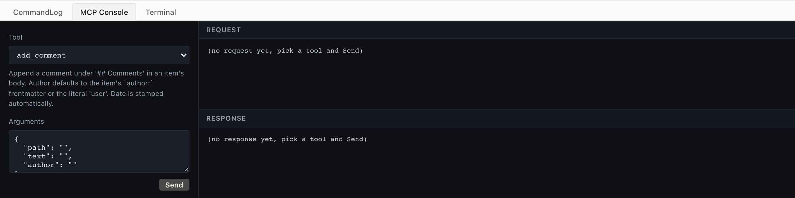
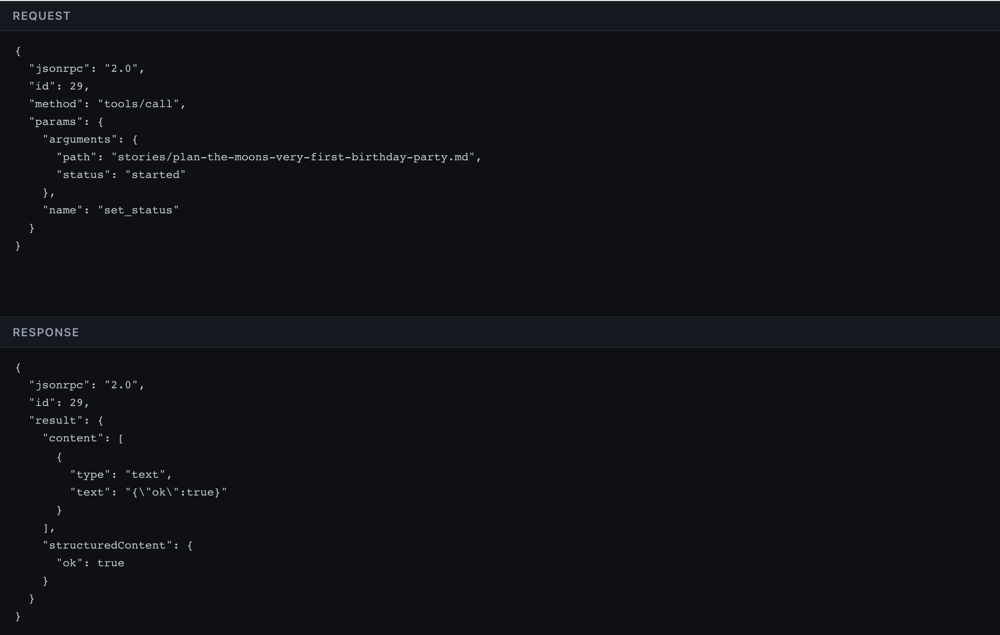

# 11. Working with an AI agent

Every chapter showed an MCP frame in the right column. This one
zooms in: how the JSON-RPC protocol works, what tools an agent
can call, and why agilemarkdown treats the agent as a first-class
collaborator instead of an afterthought.

## 11.1 What MCP is

MCP, Model Context Protocol, is a JSON-RPC dialect for tools.
A client (an AI assistant, an IDE, a custom agent) connects to a
server (agilemarkdown's `am mcp` process), discovers what
operations are available via `tools/list`, and invokes them with
`tools/call`. The board you have been clicking around in is doing
the same thing an agent would do, just through HTTP adapters over
the same underlying functions.

<table>
<tr><th>Board</th><th>CLI</th><th>MCP</th></tr>
<tr>
<td></td>
<td>

The CLI version. Pipe JSON-RPC into `am mcp` over stdio; read
JSON-RPC out. Real agents speak this protocol directly.

```
$ echo '{"jsonrpc":"2.0","id":1,"method":"tools/list"}' | am mcp
... 52 tools
```

</td>
<td>

The lab's MCP Console (this tab) is the same protocol, exposed
through a tool dropdown + args form for readability. Picking a
tool, filling args, clicking Send sends exactly the frame the
CLI does.

</td>
</tr></table>

## 11.2 The full flow: initialize → call → response

A real MCP session starts with a handshake. The lab does this
once on startup and reuses one `am mcp` child for every request.

<table>
<tr><th>Board</th><th>CLI</th><th>MCP</th></tr>
<tr>
<td></td>
<td>

```
$ cat <<JSON | am mcp
{"jsonrpc":"2.0","id":1,"method":"initialize",
 "params":{"protocolVersion":"2024-11-05",
           "capabilities":{},
           "clientInfo":{"name":"demo","version":"0.1"}}}
{"jsonrpc":"2.0","method":"notifications/initialized"}
{"jsonrpc":"2.0","id":2,"method":"tools/call",
 "params":{"name":"priority_list",
           "arguments":{"backlog":"stories"}}}
JSON
```

Three frames: initialize, the initialized notification, then the
actual tool call. The response is one JSON object per id.

</td>
<td>

Same three frames, sent transparently by the lab when you click
Send. The wire-view tab shows the exact request and response, 
copyable, paste into your agent's connection layer.

<details><summary>Full envelope</summary>

```json
{
  "jsonrpc": "2.0",
  "id": 2,
  "method": "tools/call",
  "params": {
    "name": "priority_list",
    "arguments": { "backlog": "stories" }
  }
}
```

Response:

```json
{
  "jsonrpc": "2.0",
  "id": 2,
  "result": {
    "structuredContent": {
      "backlog": "stories",
      "items": [/* 18 rows */],
      "count": 18,
      "velocity": 7
    },
    "content": [{ "type": "text", "text": "..." }]
  }
}
```

</details>

</td>
</tr></table>

## 11.3 What an agent typically does

<table>
<tr><th>Board</th><th>CLI</th><th>MCP</th></tr>
<tr>
<td></td>
<td>

The agent's view of "what should I do next" is a series of read
tools, then one write.

</td>
<td>

A typical sequence:

1. `priority_list`, see the current sprint
2. `epic_progress`, see roll-ups
3. `iteration_fit`, see if today's plan fits velocity
4. `set_status path:... status:started`, pick one up
5. work happens
6. `add_comment`, leave a note about decisions
7. `set_status path:... status:finished`, done from the dev side

Acceptance is the PM's; the agent never sends it.

</td>
</tr></table>

Working one started story at a time is also what keeps an agent
useful over a long run: its context stays scoped to the increment,
`am log` records every transition as it happens, and an unattended
session in autonomous mode is reviewable afterward through the
per-story journal (`am journal`). Decompose the work into
Pivotal-sized stories first, then the agent can grind through them —
even unattended, with permissions relaxed — and you read the journal
when you're back rather than reconstructing what happened from chat
scrollback.

## 11.4 The three-surface symmetry

All three surfaces drive the same git repo, with no central server
above them, and agilemarkdown is the state machine that keeps the
plain files on disk coherent across them.
